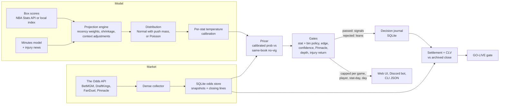
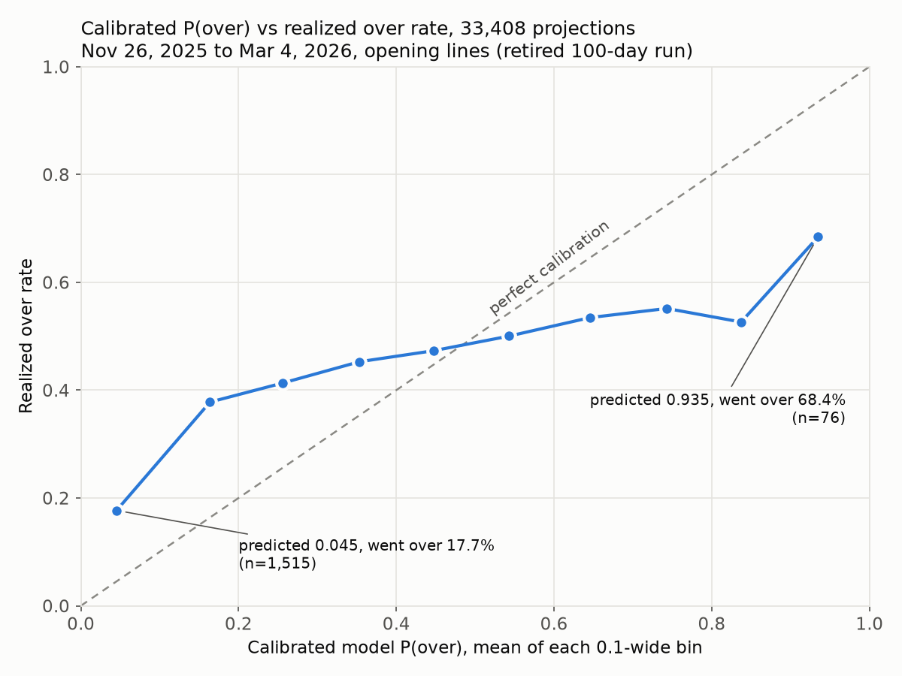

<p align="center">
  <!-- Banner slot. The reference README opens with a full-width assets/banner.png. No wide banner exists in any Courtside repo, so the 512x512 logo stands in. Swap in assets/banner.png here if one is made. -->
  
</p>

<h1 align="center">Courtside</h1>

<p align="center">
  <em>An NBA player-prop engine that prices every line against the real two-sided market, archives the closing line, and grades its own picks in a forward paper test.</em>
</p>

<p align="center">
  
  
  
  
</p>

<p align="center">
  
  
  
  
  
  
</p>

---

## Overview

Courtside projects a full distribution for every player's stat line on the slate, calibrates it, and prices it. In the sweep that feeds the journal, edge is measured against the sportsbook's own two-way no-vig probability. A pick only surfaces when its edge clears a multi-layer gate that includes a Pinnacle confirmation check. A collector snapshots BetMGM, DraftKings, FanDuel and Pinnacle through the day and archives the closing line for every prop it saw, so paper picks can be scored for CLV, and real-line backtests (`--odds-source local_history`) settle at the archived close.

The engine source is private. This repo holds the design, the validation method and the results, including the ones that went against me. The headline below is a forward paper test that lost money, scored against a market whose probabilities had a lower Brier score than the model's. It covers the positive-edge props the signal gate turned down. The smaller set the gate passed is reported beside it, and it has not cleared the GO-LIVE gate either. That is the current state of the engine, and the roadmap is built around changing it.

### Headline results

| Metric | Value |
|---|---|
| Forward paper test | 5,109 settled gate-rejected leans over 24 slates, Mar 5 to Mar 31, 2026 |
| Hit rate | 49.46% (2,527 of 5,109) |
| P&L, flat 1u stakes at the posted price | -260.74u |
| ROI | **-5.10%** |
| Brier score, model vs the book's no-vig price | 0.261 vs **0.249** (lower is better) |
| Closing line value | 236 leans beat the close, 316 lost to it, 1,550 closed at the same line (2,102 with a recorded close; line-only CLV, against the first archived close found, not necessarily the same book) |
| Signals the gate passed, points and assists | 91 settled, 52-39, +1.07u; GO-LIVE gate not passed |
| Pooled weekly walk-forward backtest (minimum edge chosen near the end of the window, see caveat) | 7,710 bets, 56.08% hit, -0.37% ROI |

> The market beat the model. On the same 5,109 leans its no-vig probabilities scored a lower Brier than ours, and the average lean with a recorded close lost 0.03 points of line to it. No version of Courtside has shown a profitable edge at real prices yet.

---

## Highlights

- **Real lines for decisions.** Backtests used for decisions run with `--odds-source local_history`, which prices each prop at its archived closing line. Props with no archived line fall back to synthetic lines unless `--real-only` is set. The backtester can also run on synthetic or opening lines; those runs count only as diagnostics, never as a decision metric.
- **Edge against the real two-sided price.** In the sweep that feeds the journal, edge is the calibrated probability of the side, with pushes removed, minus that same book's two-way no-vig probability. The interactive `prop_ev` command can instead price off Pinnacle's no-vig and the best price across books.
- **CLV where a close exists.** After the game, each pick's line is compared with one archived closing line for that prop (2,102 of the 5,109 settled leans had one). CLV is measured in line points only, not price. The GO-LIVE gate requires at least half of the scored signals with a recorded close to beat it.
- **No-lookahead mode.** With `--walk-forward`, each backtest day uses the newest weekly calibration file dated on or before it, each trained only on earlier games, and the policy checkpoint in force that day. The mode is opt-in. Without the flag a backtest uses today's calibration and policy, and days before 2025-10-28 fall back to today's calibration even with it. Keeping `date_to` in the past is a convention; the code does not enforce it yet.
- **A forward test that is allowed to fail.** Gated picks are logged to a SQLite decision journal as signals. Positive-edge props the gate rejects are logged separately as leans, with the skip reason. Both are settled after the game and backfilled with CLV where a close exists. The headline above is the lean table, which holds the props the gate turned down.
- **Calibration that is tracked.** The journal tracks a rolling model Brier against a fixed 0.240 baseline and warns when it rises above 0.252. The market comparison on this page comes from a separate read-only query of the journal. The known overconfidence of high-probability calls is documented below.
- **Tested and gated.** Nearly 40 test files and over 740 test functions, with lint, a security scan, tests with a coverage floor and a custom quality gate on every push to `master` or `dev` and every pull request to `master`.
- **A measured speed fix.** A 1-week backtest went from 26.6 minutes to under 30 seconds by fixing a per-game full-table scan, with bit-identical outputs.

---

## Architecture



---

## How it works

1. **Collect.** The dense collector pulls player props from BetMGM, DraftKings, FanDuel and Pinnacle through The Odds API and writes every snapshot to a SQLite store. The last snapshot per event, book, market and player becomes that prop's closing line.
2. **Project.** For each player on the slate, the projection engine builds a mean and a spread from recency-weighted game logs, then adjusts for defense, pace, venue, rest, fatigue, matchup history and minutes (inputs table below).
3. **Price.** The projection becomes a probability through a Normal distribution with push mass on integer lines, or a Poisson for low-count stats. Per-stat temperature calibration rescales it before any edge is computed.
4. **Compare.** In the sweep that feeds the journal, the calibrated probability of each side is compared with the same book's two-way no-vig probability. That difference is the edge. The interactive `prop_ev` command can instead price off Pinnacle's no-vig and the best price across books.
5. **Gate.** A pick has to pass the probability-bin policy, edge and confidence floors, Pinnacle confirmation, a market-depth check, and injury-return and star-replacement blocks. `best_today` and `top_picks` then cap the displayed picks per game, player, stat-day and day. The journal is not capped.
6. **Journal and settle.** Gated picks are logged as signals. Positive-edge points, rebounds and assists props the gate rejects are logged separately as leans, with the skip reason. After the game each is settled against the box score, and its CLV is filled in where an archived close exists.
7. **Decide.** The GO-LIVE gate reads the journal's points and assists signals. Until it passes, everything stays on paper.

---

## Model and methodology

### Projection inputs

| # | Input | Category | What it does |
|---|---|---|---|
| 1 | Recency-weighted averages | Baseline | Recent games count for more than older ones |
| 2 | Minutes shrinkage | Baseline | Recent minutes are blended toward season minutes with a k/(k+n) weight, so short samples cannot swing the projection |
| 3 | Variation-adaptive spread | Risk | Each player's standard deviation is scaled by his own game-to-game coefficient of variation |
| 4 | Position-aware defense | Matchup | Opponent defense against the player's position, with a pace term |
| 5 | Opponent pace on the spread | Tempo | Fast opponents widen the distribution and slow ones narrow it |
| 6 | Matchup history | Matchup | The player's past results against this opponent, bounded |
| 7 | Home and away splits | Venue | Player-specific home and road splits |
| 8 | Denver altitude | Venue | Adjustment for visiting players at Denver |
| 9 | Rest and back-to-backs | Fatigue | Player-specific rest splits |
| 10 | Rest advantage | Fatigue | Rested player against an opponent on a back-to-back |
| 11 | Three games in four nights | Fatigue | Compounding schedule fatigue beyond a single back-to-back |
| 12 | Heavy prior minutes and road trips | Fatigue | A heavy-minutes previous game, and long runs of consecutive road games |
| 13 | Post-blowout context | Context | Plus/minus as a blowout proxy, with a small bump after a blowout loss and a small cut after a blowout win |
| 14 | Minutes model | Role | Streak and volatility signals inside a bounded minutes multiplier |
| 15 | Injury-return cap | Role | Minutes capped for the first games back, scaled by games missed; a gap of four or more days counts as a layoff |
| 16 | Injury news | News | NewsAPI articles weighted by source, feeding a usage adjustment |

A separate ML outcome model (gradient boosting on 30 features) annotates each pick with its own win probability. It does not set prices, gate picks or size bets.

### Distributions and pricing

- **Poisson** for steals, blocks, threes made and turnovers.
- **Normal** for points, rebounds, assists and their combinations, with push mass on integer lines.
- **Edge**, in the sweep that feeds the journal, is the calibrated probability of the side with pushes removed, minus the same book's no-vig probability. The interactive `prop_ev` command can instead price off Pinnacle's no-vig and the best price across books. Kelly fractions are computed for each side, but the journal stakes a flat 1 unit, and every P&L figure on this page is flat 1u.

### Calibration

- **Supported in code:** isotonic calibration (by stat and side, by stat, or global) and temperature scaling (by side or stat, per probability bin or as one scalar), in that order of preference.
- **Running today:** per-stat, per-probability-bin temperature scaling, fitted on 2026-03-20 with 18,956 samples per stat from backtest results covering Oct 21, 2025 to Feb 25, 2026. No isotonic bundle has been fitted yet, so nothing earlier in the order is active.
- **Backtests in `--walk-forward` mode** use 21 weekly calibration files, dated 2025-10-28 through 2026-03-20. Each file is trained only on games before its date. The first was trained on Oct 21 to 27, 2025, with 1,150 samples per stat. A stat with fewer than 200 samples in a file falls back to that file's global temperature. Without the flag, a backtest uses the production calibration above, so any backtest inside Oct 21, 2025 to Feb 25, 2026 run without it is in-sample.
- **Known failure:** on a time-ordered last-20% split (Feb 10 to 25, 2026) of a backtest file in which only 2,829 of the 11,339 rows used real lines, and whose probabilities came from a calibration fitted on data that included those dates, high-confidence overs (chosen-side probability of 0.8 or more) were predicted at 86.68% and hit 57.14%, and high-confidence unders were predicted at 91.20% and hit 77.54%. The calibrator only sees P(over), not the chosen side, and many of its bins sit at the temperature cap. This overconfidence likely contributes to the forward Brier trailing the market, though that split has not been measured.



Calibrated P(over), averaged within ten 0.1-wide probability bins, against the realized over rate, across 33,408 projections scored day by day from Nov 26, 2025 to Mar 4, 2026 against opening lines (the retired 100-day run listed below). The model is still overconfident after calibration: the bottom bin averaged 0.045 and went over 17.7% of the time (n=1,515), and the top bin averaged 0.935 and went over 68.4% (n=76).

### Gating

Picks pass through two layers. The signal gate opens probability bins 0, 1, 8 and 9 (and 2 and 7 for points). It applies separate edge floors by side and by stat, a confidence floor, Pinnacle confirmation (when Pinnacle prices the prop, its no-vig probability for the chosen side must not fall below a set floor; props Pinnacle does not price pass this check), a two-book market-depth minimum, and injury-return, star-replacement and high-variance blocks. The betting policy then whitelists points and assists. Rebounds pass the signal gate and are logged as research signals and leans, and the GO-LIVE gate excludes them. `best_today` and `top_picks` cap the displayed picks per game, per player, per stat per day and per day; the journal is not capped. The policy is versioned in code with dated checkpoints. Only the thresholds needed to explain the results on this page are named here.

---

## Results

### Forward paper test

Every positive-edge points, rebounds or assists prop that the signal gate rejected is logged as a lean, with its line, price and skip reason. It is settled after the game, and its CLV is backfilled when an archived close exists. Leans and gated signals are kept in separate tables. From Mar 5 to Mar 31, 2026, 5,473 leans were logged: 5,109 settled as a win or loss, and 364 have no outcome. Of the 5,109, 3,322 were rejected for too little edge, 1,088 for a blocked probability bin, 539 for low confidence, 72 by the Pinnacle check, 39 for low minutes, 18 for too few games and 6 for high variance. The other 25 were backfilled as qualified signals.

| Split | Settled leans | Hit rate | P&L (1u) | ROI |
|---|---|---|---|---|
| Overs | 2,630 | 47.68% | -191.56u | -7.28% |
| Unders | 2,479 | 51.35% | -69.18u | -2.79% |
| **Total** | **5,109** | **49.46%** | **-260.74u** | **-5.10%** |

By stat: 1,986 points, 1,676 rebounds and 1,447 assists. Model Brier was 0.261 and the no-vig market's was 0.249 on the same leans. Unders lost less than overs, but neither side cleared the vig.

The signal gate passed 223 props that settled from Feb 27 to Mar 30, 2026 (two duplicate settlement rows removed): 121 wins, 101 losses and 1 push, for -7.20u (-3.2%). 128 of them were rebounds, which the betting policy excludes. Applying the GO-LIVE gate's filters (points and assists only, manually entered lines excluded) to the full history leaves 91 signals, which went 52-39 for +1.07u (+1.2%). That is too few bets to tell apart from zero, and only 17 of the 79 with a recorded close beat it (21.5%), so the **GO-LIVE gate has not passed**. Across all 166 signals with a recorded close, 30 beat it, 9 lost to it and 127 closed at the same line.

The gate scores a rolling window of points and assists signals (14 days by default and in the scheduled run). It requires at least 50 settled signals, an ROI not below zero, and at least 50% of the signals with a recorded close beating it. It also lists any stat with 20 or more signals hitting under 45%, but that list does not block the gate.

Source: the decision journal (`data/decision_journal/decision_journal.sqlite` in the private repo), latest outcome per lean and per signal, queried read-only on 2026-10-27.

<!-- Chart placeholder: assets/forward_pnl.png, the cumulative flat-1u P&L of the 5,109 settled gate-rejected leans in date order (Mar 5 to Mar 31, 2026), from the decision journal. Not generated yet. -->

<!-- Chart placeholder: assets/brier_model_vs_market.png, a two-bar Brier comparison, model 0.261 vs no-vig market 0.249 on the same 5,109 leans. Not generated yet. -->

### Backtests at real closing lines

The backtester replays the season one day at a time. For the runs below:

- Each bet is priced at the archived closing line (`--odds-source local_history`).
- In `--walk-forward` mode, each day's calibration comes from the newest weekly file dated on or before it, trained only on earlier games.
- In `--walk-forward` mode, the betting policy is looked up by date from four dated checkpoints (Oct 21, 2025; Feb 28, Mar 1 and Mar 13, 2026).
- Runs use a `date_to` before the run date. This is a convention, and the backtester does not enforce it.

| Run | Window | Bets | Hit rate | ROI | Lines |
|---|---|---|---|---|---|
| Pooled weekly walk-forward, 18 non-overlapping windows | Oct 28, 2025 to Mar 2, 2026 | 7,710 | 56.08% (95% CI 55.0 to 57.2) | -0.37% | Real closing lines |
| Season-start policy, no calibration (2026-03-02 overfitting check; not walk-forward) | Oct 21 to Nov 30, 2025 | 3,798 | 55.3% | +0.13% | Real closing lines |

Both runs come out at about breakeven. At -0.37% ROI, a 56.08% hit rate implies an average decimal price near 1.78 (about -129), so the sides the engine favored needed far more than the 52.38% a -110 line requires. One caveat on the pooled run: it applied a fixed 0.08 minimum edge with no stat whitelist to all 18 windows, and that value was set on 2026-03-01, a day before the last window closed. It is close to walk-forward but was not pre-registered. The second run predates the weekly calibration files. It used the season-start policy with no calibration; the same report got the identical 3,798 bets at +0.13% with calibration on.

Sources: the pooled run is the weekly `*_full_local_wf*.json` result files on the external odds drive, pooled on 2026-09-19. The season-start run is from the overfitting verification report of 2026-03-02. Neither file is in this repo.

### Numbers this page no longer uses

| Number | Why it was retired |
|---|---|
| 75.9% hit, +38% ROI on 632 wagers (this page's previous headline) | Priced at opening lines, not closing lines: in the source file the opening line equals the priced line on all 33,408 rows. The gate also applied the live policy back across Nov 26 to Mar 4, but the stat whitelist (Feb 28), the 0.08 minimum edge (Mar 1) and the restriction to bins 0 and 9 (Mar 3) were chosen with that window's data in view. That makes it in-sample. Without the gate, the same projections hit 52.62% at -1.92% ROI. |
| 65.6% hit, +19.6% ROI on 384 bets, Oct 21 to Nov 30, 2025 | The stat whitelist, the blocked bins, the 0.05 to 0.08 minimum edge and a calibration fitted on Dec 1 to Feb 25 were all chosen on later data and then applied back to Oct and Nov. In-sample. The season-start policy with no calibration returned +0.13% on 3,798 bets over the same window. |
| "9.1M+ [odds snapshots] across the 2025-26 season" | The 9.1M figure spans three seasons, Oct 2023 to Apr 2026. |
| "Prices are de-vigged with Pinnacle as the sharp reference book" | The journal path prices against each book's own no-vig. Pinnacle's no-vig is a confirmation gate there, and a reference price only in the interactive `prop_ev` command. |
| "XGBoost for the models" | Prices come from Normal and Poisson distributions on the projection. The ML outcome model only annotates. |

---

## Engineering

### Backtest speed

A cProfile of a 1-day backtest put 1,043.6 of 1,085 seconds (96%) in a single event lookup. Its date predicate was wrapped in SQL functions, which blocked the commence-time index, so every game full-scanned 6.4M snapshot rows. An indexed commence-time range query with a per-date memo, plus a prebuilt player-name lookup, took a 1-week backtest from 26.6 minutes to under 30 seconds (1,594 s to 23.7 to 26.5 s over two runs). All 8,712 `compute_ev` calls stayed bit-identical to the old run, and the tests killed all 12 mutants of the new lookup.

Separately, a Rust EV kernel in another private repo runs 3.8x faster than the Python loop, with output parity on 8,712 real prop lines. EV math is a tiny share of backtest time, so the kernel is not an end-to-end speedup.

### Data scale

- **Odds snapshots:** 9.1M+ across three seasons, Oct 2023 to Apr 2026.
- **Closing lines archived:** 877K+.
- **Archive books:** BetMGM, DraftKings and FanDuel. The live collector also pulls Pinnacle.

These totals come from the owner's query of the full 5.2 GB three-season database, which is not part of either repo. The walk-forward runs above predate the April 2026 data expansion, so they did not run over the whole archive.

### Testing and CI

The private repo runs a `quality-gate` GitHub Actions workflow on every push to `master` or `dev` and every pull request to `master`. It runs on Ubuntu with Python 3.12:

1. Lint with ruff
2. Security scan with bandit
3. pytest with coverage, excluding tests that need local data, against a 38% coverage floor
4. `scripts/quality_gate.py --json`: compile check, JavaScript syntax and import checks, hallucination-pattern scan, and smoke tests

The suite on `master` has 37 test files and 744 test functions. The last full local run (2026-09-15) had 699 passed, 61 skipped and 11 failed. The 11 failures are tests that need local data files, and they fail the same way on `master`.

<!-- Chart placeholder: assets/backtest_speed.png, a two-bar wall-time comparison for the 1-week backtest, 1,594 s before vs 23.7 to 26.5 s after. Not generated yet. -->

---

## Daily picks

`scripts/register_scheduled_tasks.ps1` registers three Windows scheduled tasks that run the loop:

- **NBA-MorningSettle**, daily at 10 AM: `scripts/scheduled_settle.py` settles the previous slate and prints the paper summary over a 14-day window, including the GO-LIVE gate.
- **NBA-CollectLines**, weekdays at 12, 3, 6 and 8 PM: snapshots points, assists, rebounds and PRA lines from BetMGM, DraftKings and FanDuel.
- **NBA-FullPipeline**, weekdays at 6:30 PM: `scripts/scheduled_pipeline.py` collects lines, runs `roster_sweep` (which prices, gates and journals signals and leans) and prints `best_today 20`.

The same steps by hand, from the repo root:

```powershell
# Morning: settle the previous slate, then the rolling summary and GO-LIVE gate
.\.venv\Scripts\python.exe nba_mod.py paper_settle 2026-10-26
.\.venv\Scripts\python.exe nba_mod.py paper_summary --window-days 14

# Evening: collect lines, price, gate and journal signals and leans, then print the top 20
.\.venv\Scripts\python.exe nba_mod.py collect_lines --books betmgm,draftkings,fanduel --stats pts,ast,reb,pra
.\.venv\Scripts\python.exe nba_mod.py roster_sweep
.\.venv\Scripts\python.exe nba_mod.py best_today 20

# Copy collected line snapshots into the odds store so closing lines can be built for CLV
.\.venv\Scripts\python.exe nba_mod.py line_bridge --books betmgm,draftkings,fanduel --stats pts,ast
```

`scripts/daily_pipeline.ps1` is an older manual script (settle, collect, bridge, summary). It does not run the sweep.

For the slate itself, `nba_mod.py best_today 15` and `nba_mod.py top_picks 5` print the ranked, gated picks as JSON. The same picks appear in the web UI's Picks tab and through the Discord bot's `/picks` command. The bot also has `/gate`, `/summary`, `/health`, `/lines` and `/injuries`.

The web UI is an Alpine.js and Chart.js front end with seven tabs: tonight's picks and gate scorecard, the slate, line collection, single-prop analysis, live projection, results and reference. It is served by a stdlib HTTP server on port 8787 with about 40 `/api/*` routes.

Graded daily picks are not published yet. See the roadmap.

---

## Project structure

The engine lives in a private repo. Its layout:

```
nba_mod.py            CLI entry point; the last stdout line is always JSON
server.py             Facade over server/ (stdlib ThreadingHTTPServer, port 8787)
server/handler.py     Route table (~40 /api/* routes); handlers in server/routes/
nba_cli/              15 command modules registering 70 commands
core/                 Engine modules
  nba_prep_projection.py   Projection and context adjustments
  nba_minutes_model.py     Minutes multiplier and injury-return caps
  nba_injury_news.py       Source-weighted injury news
  nba_ev_engine.py         Normal and Poisson pricing, no-vig edge, Kelly
  _calibration.py          Isotonic and temperature calibration paths
  gates.py, policy/        Signal gates and the versioned policy
  nba_odds_store.py        Snapshot store and closing-line builder
  nba_line_store.py        JSONL line-history store (collect_lines output)
  _bet_utils.py            Line-based CLV used by settlement
  journal/                 Decision journal: schema, settlement, queries
  nba_backtest.py          Backtest orchestrator (no-lookahead with --walk-forward)
  nba_parlay_engine.py     Correlation-aware parlay pricing
  nba_risk_metrics.py      Drawdown, Sharpe, Calmar, streaks
  _ml_*.py                 ML outcome and projection models (annotation only)
scripts/              Collector, scheduled tasks, calibration fits, odds backfill, Discord bot, quality gate
web/                  Alpine.js UI, 7 tabs
models/               prob_calibration.json, policy_history.json, walk_forward/ (21 weekly files)
tests/                ~40 files, 740+ test functions
.github/workflows/    quality-gate.yml
```

This public repo holds this README and the figures in `assets/`. The charts from the retired 632-wager run were removed.

---

## Setup

These steps apply to the private engine repo. They are here to show how a run is put together.

### Prerequisites

- Python 3.12 or newer (CI runs 3.12; developed on 3.14)
- A key from [The Odds API](https://the-odds-api.com/) for live lines
- Optional: a NewsAPI key for injury news, and a local Ollama model or an Anthropic key for the written analysis
- For backtests: the odds history archive and a local box-score index built from the Kaggle NBA database. Neither is distributed.

### 1. Installation

```powershell
python -m venv .venv
.\.venv\Scripts\python.exe -m pip install --upgrade pip
.\.venv\Scripts\python.exe -m pip install -r requirements.txt
Copy-Item .env.example .env   # then add ODDS_API_KEY
```

### 2. First run

```powershell
# Build the local box-score index (needed for --local backtests)
.\.venv\Scripts\python.exe scripts\index_local_data.py --input-dir "<Kaggle NBA database folder>" --output "data\reference\kaggle_nba\index.pkl"

# Start the UI at http://127.0.0.1:8787
.\.venv\Scripts\python.exe server.py
```

### 3. A real-line backtest

```powershell
# --walk-forward: dated calibration and policy per day; --real-only: drop props with no archived line
# keep date_to before today (a convention; the code does not enforce it)
.\.venv\Scripts\python.exe nba_mod.py backtest 2026-01-26 2026-02-25 --model full --local --odds-source local_history --real-only --walk-forward --save
```

A Dockerfile is included: `docker build -t courtside .` and `docker run -p 8787:8787 --env-file .env courtside`.

---

## Configuration

| Variable | Purpose |
|---|---|
| `ODDS_API_KEY` | Live odds, line collection and odds backfill |
| `NEWS_API_KEY` | Injury and news signal |
| `ANTHROPIC_API_KEY` | Claude fallback for the written analysis (optional) |
| `LLM_PROVIDER_ORDER` | `ollama_first` (default) or `claude_first` |
| `LIGHTRAG_ENABLED` | Turns on the optional LightRAG knowledge graph (default `false`) |
| `LIGHTRAG_BASE_URL` | LightRAG server URL (default `http://localhost:9621`) |

The written analysis runs on a local Ollama model (`gpt-oss:20b`) first and falls back to Claude. If both fail, the analysis returns an error. It writes the narrative and is not part of the pricing path. The betting policy and signal spec live in code, with dated checkpoints in `models/policy_history.json`.

---

## Roadmap

1. **A pre-registered 2026-27 forward test.** Freeze the policy at a pinned commit before the window opens, log every pick with a timestamp and the price taken, grade at that price, and record CLV against both the book's close and Pinnacle's. At a true 54% hit rate on -110 prices, separating from breakeven takes about 5,900 independent bets (one-sided alpha 0.05, 80% power). Correlated same-game bets push that higher.
2. **Calibration that beats the market.** Try market-anchored probabilities (the line-blend path exists but was switched off on 2026-03-03 after a factorial test found raw probabilities had the better Brier on 5 of 7 stats) and fit the per-side isotonic bundle the code already supports. A change ships only if its Brier beats the no-vig market's 0.249 on real-line rows.
3. **A leak guard on the ML features.** Keep closing-line and CLV features out of any pregame model. Then test the 30-feature outcome model against the market on real-line rows only. On a time-ordered 20% split of a mostly synthetic-line backtest file (Feb 10 to 25, 2026), it scored a Brier of 0.2195 against 0.2249 for the formula probabilities. It has not been scored against the market.
4. **Graded daily picks in public.** A dated picks file with results and CLV filled in after settlement.
5. **The official NBA injury report** as a feed, since status changes near tip move lines.
6. **A staking module** with per-bet and correlated-exposure caps, built only after item 1 or 2 shows an edge.

---

## Disclaimer

> Courtside is a research and portfolio project, and nothing here is betting advice. The forward paper test lost money, and no version of the engine has shown a profitable edge at real prices. Sports betting carries real financial risk.

---

## License

There is no open-source license. The engine source is private and not licensed for reuse. The text and figures in this repo are shared for viewing.

---

## Contact

Ronil Basu, Rutgers University-New Brunswick, BS Data Science

[linkedin.com/in/ronil-basu](https://linkedin.com/in/ronil-basu) · ronilbasu@gmail.com
